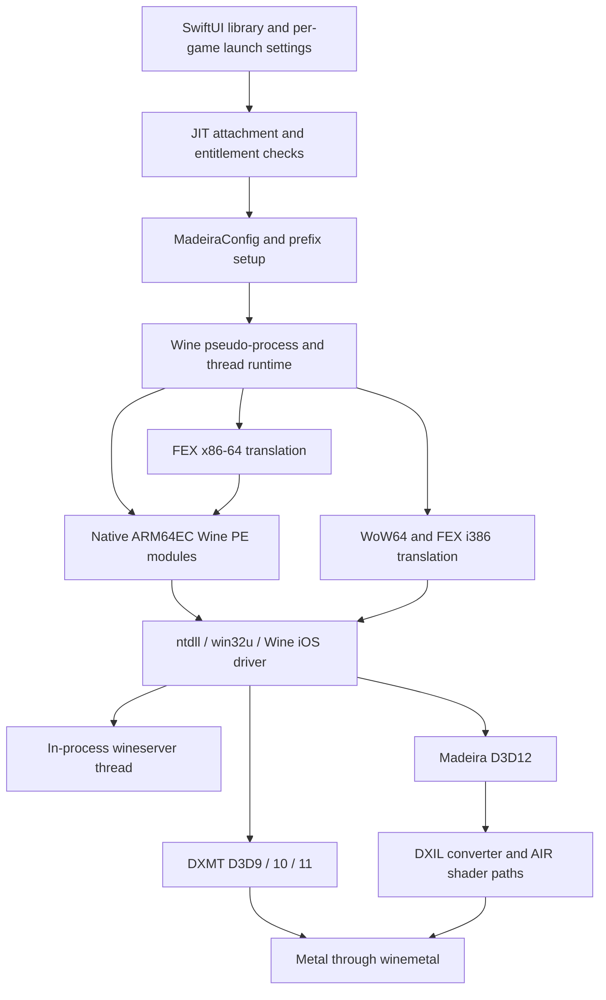

# Madeira architecture audit — 2026-10-10

## Scope and provenance

This is a source audit and Windows host test record, not a device compatibility certification. The foundation is [Madeira](https://github.com/willfaust/Madeira) at `48f976429c189f8396e23d251d8a82f43c705922`. No dependency pin or submodule source was changed. The engineering changes are intentionally confined to build safety, offline diagnostics, tests and documentation.

| Component | Exact gitlink | Verified source identity |
|---|---|---|
| FEX | `3bec2ac498bf78156ab47c0c194b0e8cb2849756` | `ios-port-2607`; upstream FEX-2607 commit `1cc4b93e7a71c883ec021b71359f136394dc1f3c` is an ancestor |
| Wine | `257f271cfffed9f22f7987cac53bc00095d092fe` | `madeira-lgpl`, VERSION 11.4 |
| DXMT | `db546ee466ad50ec6463edb5fa183de11db43761` | `ios-port`, describe `v0.73-151-gdb546ee` |
| Madeira Dock | `72558e416a390f3669457930f09a389e54f49556` | Dedicated x86-64 PE Steam host, staged in the ARM64EC farm and translated by FEX |

[source-inputs.json](evidence/source-inputs.json) records every discovered nested gitlink, its expected/actual revision, dirty state, missing inputs and hashes of bundled PE/converter binaries. There are 24 discovered gitlinks including the four above. Windows initialized 21 at the required revisions; three optional Linux-only FEX test-binary repositories were not fetched. CI requests all recursive submodules. A source SHA does not prove that the already tracked DLLs were built from that SHA.

Read: README, CONTRIBUTING, COPYING, LICENSE-EXCEPTION, THIRD-PARTY notices, BUILDING, LICENSING, Wine provenance, JIT, WoW64, Steam/library/cloud, media and controller docs; dependency build scripts and contribution notices. The older BUILDING claim that fork revisions have not been published is historical: the required initialized revisions were fetched in this audit. Its UNVERIFIED build steps remain unverified here.

## Main execution paths

### Launch, JIT and exception handling

`app/Madeira/ContentView.swift` prepares the library entry, per-game configuration, session log, launch route and Wine sequence. `StikJITHelper.swift`, built-in JIT support and `JITAllocator.c` implement existing attachment and executable-memory paths. A signing entitlement alone is insufficient: current runtime checks require the debug state and a live attachment. Built-in pairing has container limitations; StikDebug/existing attachment paths remain intact. CI retains the upstream entitlements and builds unsigned for later signing.

The fork is not stock FEX on Linux. Its iOS/ARM64EC integration, memory callbacks, allocator changes, exception translation and host feature assumptions are part of the port. `build/ntdll-unix/signal_arm64_ios.c` bridges Mach exceptions and Windows guest exceptions, handles executable aliases/store decoding, logs sparse JIT state and guards repeated fault redelivery. `MADEIRA_JIT_DUMP=0` disables existing dumps. Some exception events are expected guest control flow; matching an exception line does not establish a crash.

### Processes, threads and virtual memory

Wine guests and wineserver run inside one iOS process. `process_ios.c`, `thread_ios.c`, `virtual_ios.c`, the signal bridge, server shims and the FEX context cooperate to implement Windows process/thread semantics. PE image ownership, guest PIDs, TEB switching, handle/lifetime management and owner-specific mappings matter; native POSIX process assumptions are unsafe here.

Executable pools use writable/executable aliases and constrained address bands. Memory bookkeeping must distinguish reserved address space, committed guest mappings, JIT allocations and physical footprint. Optional swap and madsync are already present and must not be enabled globally without evidence. `build/wineserver/mach_ios.c` leaves real thread suspension opt-in because suspending a guest while it owns a shared allocator or FEX lock can deadlock other guests. This is directly relevant to stop-the-world garbage collectors, but is not proof of the cause of any particular Unity failure.

### Graphics

DXMT translates D3D10/11 and has D3D9 paths/configuration; its Metal bridge and shader compiler are customized for iOS. AIR/LLVM compilation, command submission, resource synchronization and texture decode/upload paths all need device profiling. The D3D9 import includes LGPL material; do not describe the entire dependency as MIT.

DirectX 12 uses Madeira's own PE runtime plus a unix/Metal side, not VKD3D. Apple Metal Shader Converter handles DXIL; AIR paths cover shader-model-5 cases. Source contains unsupported methods/capabilities (`E_NOTIMPL`), and tiled resources remain an opt-in, fully backed emulation. Successful feature enumeration or a microtest cannot certify a game's D3D12 compatibility. Modern DX12 titles remain test targets.

### Steam and app services

SwiftSteam supplies authentication, owned-library metadata and depot downloads. Madeira Dock hosts actual Valve client interfaces, with ABI/hash guards. Cloud sync and local saves have separate lifecycle rules. Controller, touch, audio, video and Wine desktop functionality already exist. None of these execution paths is changed by this milestone. No DRM or anti-cheat bypass is added.

### Existing diagnostics and the initial addition

| Facility | Evidence available | Limits |
|---|---|---|
| `LogStore.swift` | Current/previous log and hardlinked per-executable sessions under Documents/logs; retention of 40 sessions | A hardlink can include later appended session activity; export a stopped log and check launch markers |
| `DeviceDiagnostics` / `EntitlementChecker.swift` | Model, OS, RAM/available memory, CPU count, signing, address map, thermal/low-power state and launch snapshot | Not a continuous CPU/GPU/thermal profile |
| `BuildStamp`, launch/config output | Runtime stamp, target executable, WINEDEBUG, FEX/DXMT/config evidence | Old packages may only have version information, not an exact source SHA |
| Mach/guest exception and JIT logs | First fault, instruction/address context and redelivery protection | Abrupt iOS kill may leave no last event; logs and symbols must match |
| Wine iOS freeze detector | Scheduling/liveness gaps; explicit backgrounded vs unexplained gaps | A gap does not locate a CPU or GPU bottleneck; detector failure is itself relevant |
| `FPSOverlay` | Existing present-counter estimates and periodic footprint display | No individual frame intervals exported; display refresh is not game FPS; no new GPU timing claimed |
| New `tools/diagnostics/report.py` | Bounded pattern counts, line references, log hash, memory groups, supplied metadata, JSON/Markdown export and optional explicit frame-CSV statistics | Offline only; no new native crash handler, clean-exit marker, device sampler or automatic compatibility verdict |

Diagnostic modes for this milestone are offline summary (default), bounded excerpts (opt-in) and explicit frame-CSV analysis. They add no gameplay logging or scheduling work. Existing native log verbosity remains controlled by upstream configuration. The next runtime addition should be a low-frequency persisted lifecycle/memory breadcrumb only after a native build and regression baseline exist. Do not allocate, lock, or format JSON in Mach/signal handlers.

## Findings and performance hypotheses

Verified source/build problems: missing clean wineserver archive recipe; first-run ARM64EC toolchain triple absent from the wrapper; ntdll build could archive old objects after compile failures; config catalog used OS-dependent path separators; `wintypes.dll` absent from the packaged ARM64EC farm despite available Wine source. Only the small wrapper/catalog defects are changed here.

Unmeasured hypotheses: translated-code compilation/cache churn, cross-guest lock contention, alias/protection churn, shader/pipeline compilation, Metal submission waits, resource uploads and memory-pressure/thermal effects may dominate different games. No hotspot ranking or FPS improvement is claimed. Use the experiment protocol in [PERFORMANCE_BASELINE.md](PERFORMANCE_BASELINE.md).

## Alternative technologies

| Candidate | iOS/JIT feasibility, cost and expected benefit | License/integration decision |
|---|---|---|
| Selected newer FEX changes | Potential instruction/codegen fixes; retain iOS host backend, alias and ARM64EC contracts; benchmark cache/memory cost | Upstream MIT plus fork notices/exception; no AI-generated upstream contribution. Isolated branch only |
| Selected Wine fixes/modules | Potential broad import/API/runtime gains; architecture farm and server semantics must agree | LGPL and corresponding-source/relink obligations; smallest validated changes first |
| DXVK + MoltenVK | Vulkan portability subset and extra SPIR-V-to-MSL layer; Vulkan extension/feature gaps and pipeline/memory cost need a capability probe | DXVK zlib, MoltenVK Apache-2.0; substantial integration. Do not assume Android performance transfers |
| VKD3D-Proton + MoltenVK | Higher Vulkan feature requirements and extra translation; no established iOS benefit in this audit | LGPL component review; high complexity and memory risk. Defer until D3D12 failures are characterized |
| Alternative shader translation | Could improve particular unsupported shaders; compare correctness, compile time, cache size and Metal feature availability | Review each compiler's terms and Apple converter agreement; retain current working paths |
| Box64 techniques | Ideas for dispatch, flags and caching only; Linux assumptions are not iOS implementations | MIT; no wholesale translator replacement without correctness/performance suite |
| Selected Proton components | Some Wine/media/game fixes may be separable; Steam Runtime/Linux containers and kernel services are not portable by assumption | Mixed component licenses; evaluate individual patches, not a full Proton port |

Primary references: [GameNative](https://github.com/utkarshdalal/GameNative) at `df8e320604ca6235a6e6ed27cb75a0c8e37e9b28`, [FEX contributions](https://github.com/FEX-Emu/FEX/blob/main/CONTRIBUTING.md), [Wine](https://gitlab.winehq.org/wine/wine), [DXMT](https://github.com/3Shain/dxmt), [DXVK](https://github.com/doitsujin/dxvk), [MoltenVK](https://github.com/KhronosGroup/MoltenVK), [VKD3D-Proton](https://github.com/HansKristian-Work/vkd3d-proton), [Proton](https://github.com/ValveSoftware/Proton), [Box64](https://github.com/ptitSeb/box64). These are evaluation references, not newly adopted dependencies. Recheck contribution policies before any later submission; not every candidate's current policy was exhaustively reviewed.

GameNative's `BestConfigService` and `ContainerOverlay` suggest versioned per-game/device/GPU/store matching, fallback provenance and explicit overrides. Madeira already has per-game settings; evolve those later. GameNative's Android containers, Bionic/GLIBC and X-server arrangements cannot be copied into this iOS runtime. No GameNative code is incorporated.

## License boundaries

Preserve GPL-3.0-or-later and the adopted Madeira Converter Exception, Wine LGPL provenance and all bundled notices. FEX's `AGENTS.md` and contribution policy prohibit AI-generated upstream code; no FEX edits or upstream submissions were made. The checked-in Apple converter is covered by the agreement beside it, whose distribution scope is shader conversion on Apple devices; this audit adds no Apple downloads or new proprietary payload. Microsoft VC runtime DLLs are not supplied. Optional user-installed runtimes must follow their own distribution terms. The upstream licensing document's unresolved clean rebuild/relink/install and release-review requirements remain open. This report does not certify legal compliance of a finished distribution.
